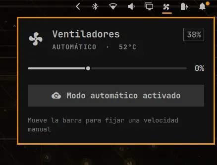

# fan-control

Bar widget for Omarchy that controls the laptop fans via **nbfc** (NoteBook FanControl): it shows speed/temperature, lets you set a manual speed (0–100%) with a slider, and switch back to automatic mode.



## Requirements

This widget **requires nbfc installed and its service active**. Without it, the widget only shows a notice.

On Arch/Omarchy:

```sh
# Install nbfc (available in the AUR)
yay -S nbfc-linux

# Enable the system service
sudo systemctl enable --now nbfc_service

# (Optional) load a profile for your laptop model
sudo nbfc config --set auto
```

nbfc talks to its system service over a socket, so **no sudo is needed** to use the widget:

- `nbfc status` → fan state (target speed, automatic mode, temperature)
- `nbfc set -s N` → manual speed for all fans (disables automatic control)
- `nbfc set -a` → profile-based automatic control

## Usage

Clicking the bar icon opens a card with:

- Current status (automatic/manual, temperature, and target speed).
- 0–100% speed slider (moving it enables manual mode).
- Button to switch back to automatic mode.

If `nbfc` is not installed, the icon appears dimmed and the card shows the installation instructions.